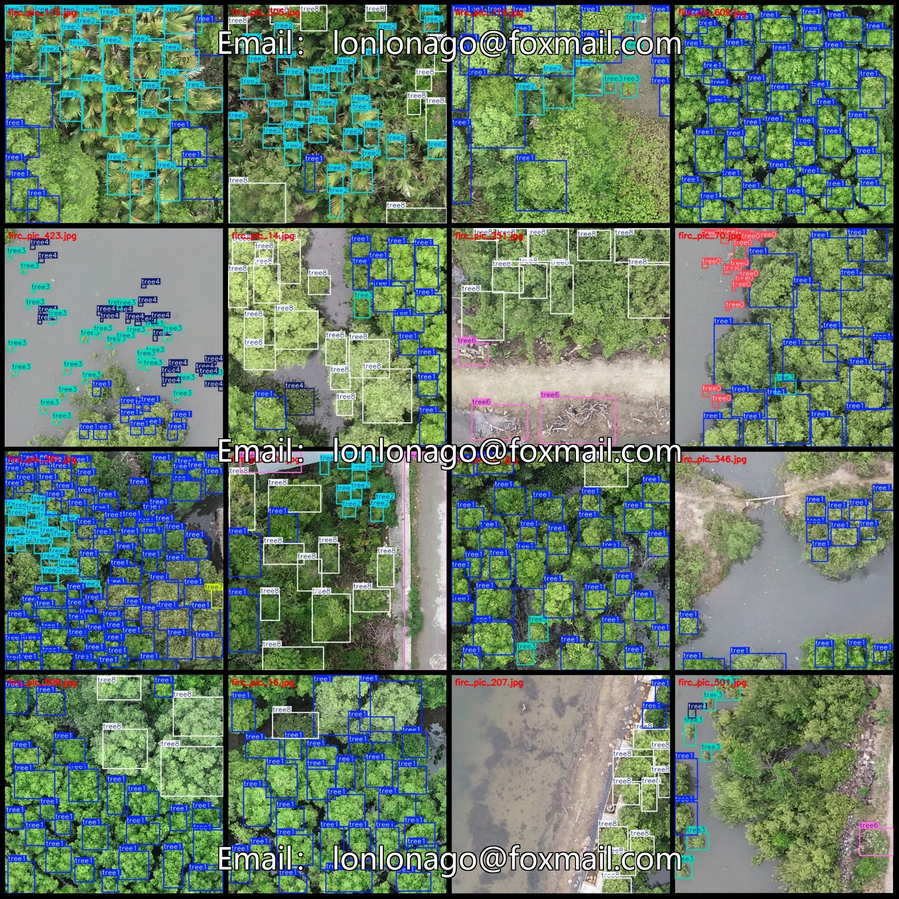
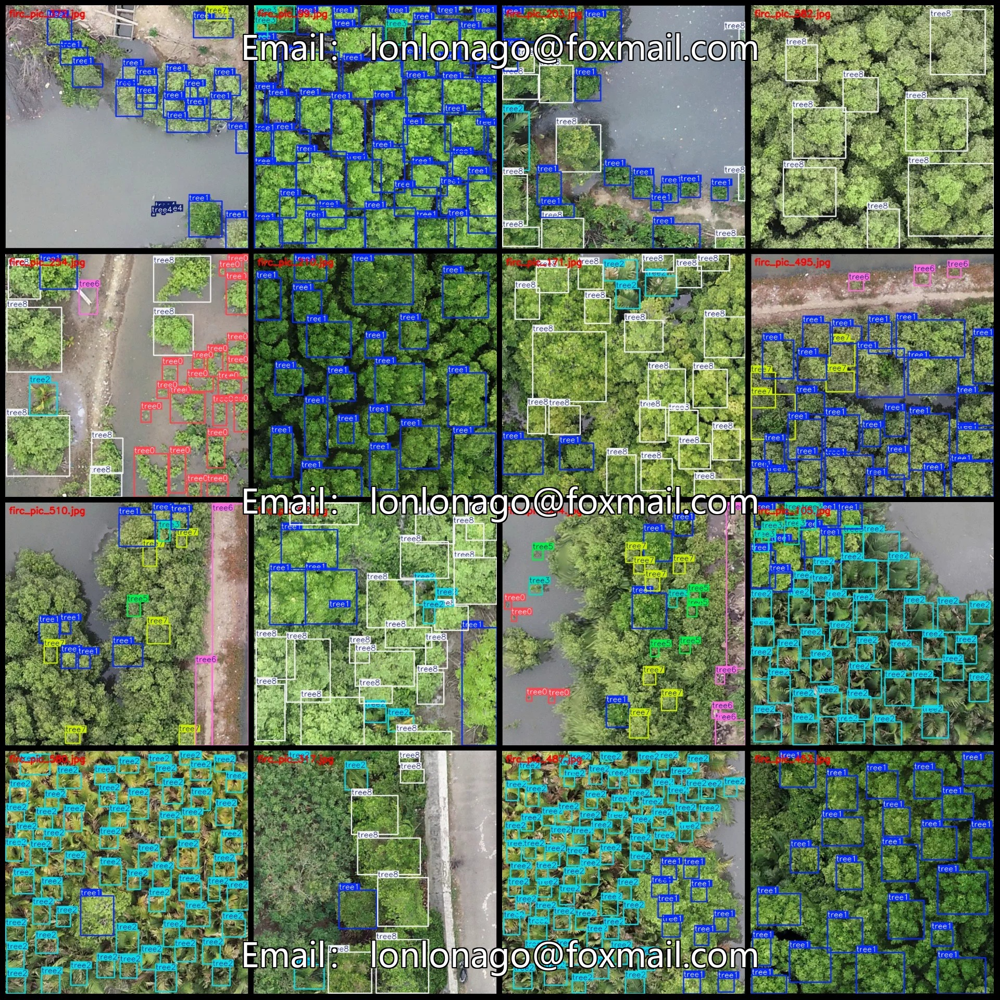
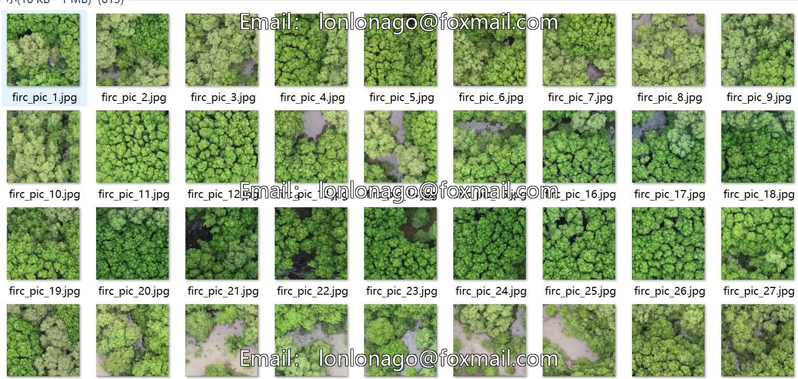
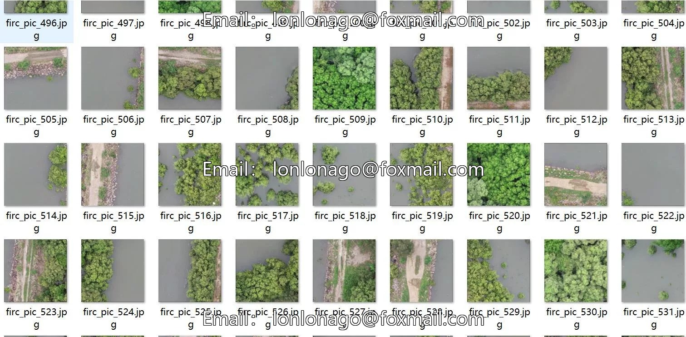

# Wetland mangrove target detection dataset VOC+YOLO format with 613 images in 9 categories

## Body

Wetland mangrove target detection dataset VOC+YOLO format: 613 images in 9 categories
Tips: Due to the dataset's replicability, please confirm compliance before purchasing.
Dataset format: Pascal VOC format + YOLO format (txt file without split path, only containing jpg images and corresponding VOC format xml files and yolo format txt files)
Number of images (number of jpg files): 613
Number of annotations (number of xml files): 613
Number of annotations (number of txt files): 613
Number of annotation categories: 9

Annotation category names (Note that the order of categories in the YOLO format does not correspond to this, but is based on the classes.txt file in the labels folder): ["tree0", "tree1", "tree2", "tree3", "tree4", "tree5", "tree6", "tree7", "tree8"]
Number of bounding boxes per category:
tree0 = 466
tree1 = 8895
tree2 = 2649
tree3 = 1302
tree4 = 1522
tree5 = 36
tree6 = 740

Tree 7: Number of frames = 298
Tree 8: Number of frames = 2925
Total number of frames: 18833
Number of images per category
Tree 0: Number of images = 68
Tree 1: Number of images = 553
Tree 2: Number of images = 182
Tree 3: Number of images = 258
Tree 4: Number of images = 149
Tree 5: Number of images = 26
Tree 6: Number of images = 191
Tree 7: Number of images = 68
Tree 8: Number of images = 263
Image resolution: 640x640
Labeling tool used: labelImg

Annotation rules: Draw a rectangle around the category.
Important Notice: The dataset does not have separate training, validation, and test sets; you need to partition them yourself.
Special : This dataset does not guarantee the accuracy of the trained models or weight files.

## Images

## Payment

Here is a pay link on Stripe ( https://buy.stripe.com/3cs8yP7sY87d0vu9AB ). Please contact me lonlonago@foxmail.com after funding $89, and I will send you a complete data files , thank you!

